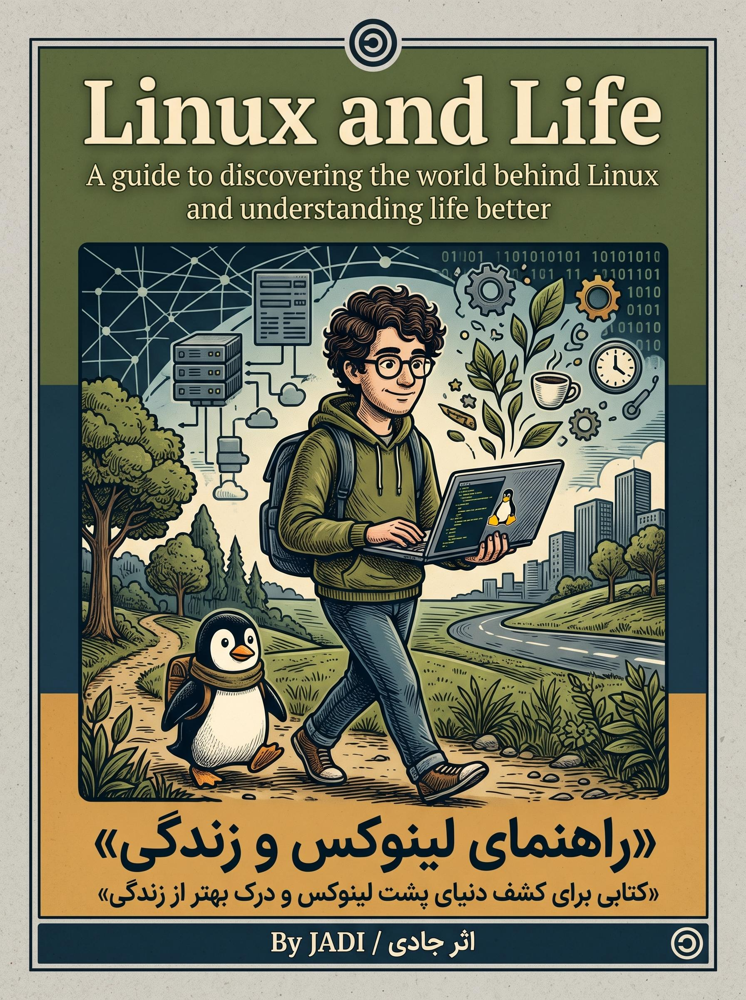

  

<h1 align="center">🐧 کتاب لینوکس و زندگی (Linux and Life)</h1>

  <strong>راهنمای زیستن در دنیای نرم‌افزارهای آزاد، درک روح هکری و تسلط بر خط فرمان لینوکس — اثر جادی میرمیرانی</strong>

  
  
  
  
  

---

## 💡 چرا این کتاب؟

کتاب **«لینوکس و زندگی»** اثر *جادی میرمیرانی*، فقط یک راهنمای فنی برای حفظ کردن دستورات ترمینال نیست؛ این کتاب مانیفستِ تجربه زیسته، درک فرهنگ آزادی دیجیتال و لذت رهایی از محدودیت‌های سیستم‌عامل‌های بسته است:
* 🎯 **فلسفه و جهان‌بینی نرم‌افزار آزاد:** چرا انتخاب لینوکس فراتر از یک انتخاب فنی است و چگونه آزادی نرم‌افزار به آزادی تفکر پیوند می‌خورد.
* 💻 **از نصب تا خط فرمان و تسلط بر ابزارها:** آموزش عملی توزیع‌ها، مدیریت پکیج‌ها، متغیرها، پایپ‌ها، شبکه، امنیت و سفارشی‌سازی دسکتاپ.
* 🌍 **بیانی گرم، طنزآمیز و صمیمی:** متنی شیوا و خواندنی که خواننده را بدون خستگی در مسیر یادگیری هکری هدایت می‌کند.

---

## ⚡ دسترسی سریع

| مرجع | توضیحات | لینک |
| :--- | :--- | :---: |
| 📖 **نسخه وب تعاملی (گیتاب)** | تجربه خواندن جذاب با پوسته تاریک/روشن، فهرست کامل و فونت چشم‌نواز | [ورود به گیتاب ↗](https://hheydarian.github.io/Gitab/books/book12/) |
| 📥 **سورس فصول کتاب** | دسترسی مستقیم به تک‌تک فایل‌های متنی و مارک‌داون فصول | [مشاهده فصول در گیت‌هاب ↗](Book/) |

---

## 🔍 راهنمای خوانایی بهتر در گیت‌هاب

برای این‌که متون فارسی در گیت‌هاب با قلم استاندارد و زیبا به نمایش درآیند:
1. افزونه رایگان **[فونت ایران (FontIran)](https://chromewebstore.google.com/detail/fontiran/edbchgkbejkdkdkpgenlaciegoidmjoh)** را روی مرورگر نصب کنید.
2. فونت را روی **وزیرمتن (Vazirmatn)** تنظیم کنید تا کدهای ترمینال و متن فارسی هماهنگ و چشم‌نواز دیده شوند.

---

## 📚 فهرست سرفصل‌ها و بخش‌های کتاب

این اثر در **۳۵ فصل کاربردی** و **۶ بخش جامع** تدوین شده است:

| بخش | موضوعات محوری | تعداد فصول | وضعیت |
| :---: | :--- | :---: | :---: |
| **بخش ۱** | آشنایی با لینوکس، پیشینه تاریخی و فلسفه آزادی نرم‌افزار | ۶ فصل | ✅ |
| **بخش ۲** | گام‌های اولیه، انتخاب توزیع، نصب و کاوش در محیط گرافیکی | ۵ فصل | ✅ |
| **بخش ۳** | ورود به ترمینال (CLI)، ناوبری فایل‌ها و دستورات اصلی یونیکس | ۶ فصل | ✅ |
| **بخش ۴** | مفاهیم شبکه، اینترنت، ارتباطات امن و سرویس‌های پایه | ۵ فصل | ✅ |
| **بخش ۵** | امنیت، حریم خصوصی، مدیریت دسترسی‌ها و محافظت از داده‌ها | ۶ فصل | ✅ |
| **بخش ۶** | تنظیمات پیشرفته، خودکارسازی، اسکریپت‌نویسی و زندگی هکری | ۷ فصل | ✅ |

---

## 🤝 مشارکت در پروژه (Contributions Welcome)

این کتاب یک پروژه جامعه‌محور و آزاد است. هرگونه اصلاح غلط‌های املایی، بهبود توضیحات یا به‌روزرسانی دستورات با ابزارهای نوین لینوکس ارزش کار را بالا می‌برد:

1. **فورک (Fork):** مخزن را فورک کرده و شاخه اختصاصی ایجاد کنید (`git checkout -b patch/edit-text`).
2. **ویرایش:** فایل‌های مربوطه را اصلاح فرمایید.
3. **ارسال PR:** درخواست پول ریکوئست خود را با توضیحات ثبت نمایید.

---

## ⚖️ مجوز و حقوق نشر

* **مؤلف:** جادی میرمیرانی (Jadi Mirmirani)
* **مجوز انتشار:** این کتاب به‌صورت کاملاً آزاد و متن‌باز تحت لایسنس **Creative Commons** منتشر شده و برای همگان رایگان است.

---

  ⭐ <strong>اگر این کتاب و راهنما برای شما مفید بوده، با دادن یک ستاره (Star) به گسترش آن در جامعه متن‌باز کمک کنید!</strong> ⭐

  با عشق به جامعه لینوکس و متن‌باز ایران ❤️🐧

